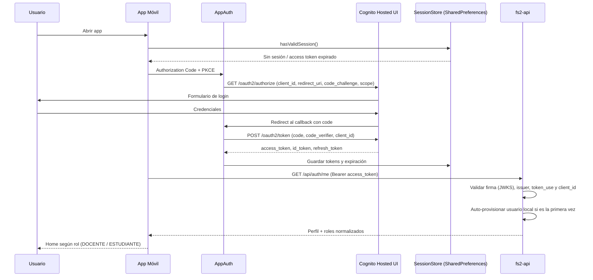
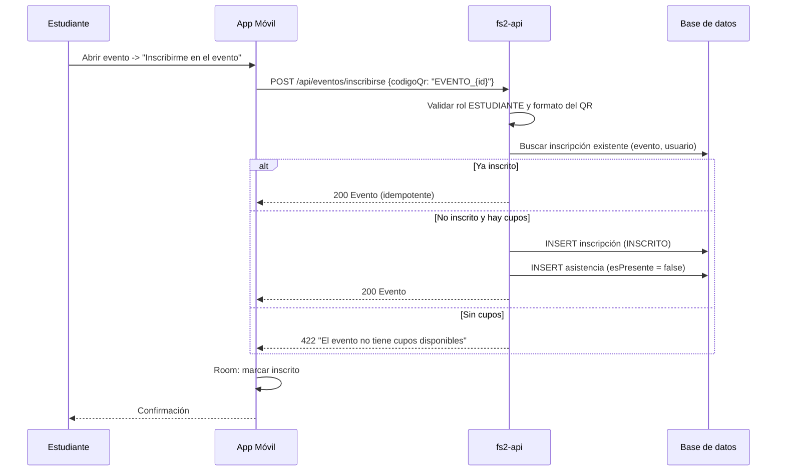
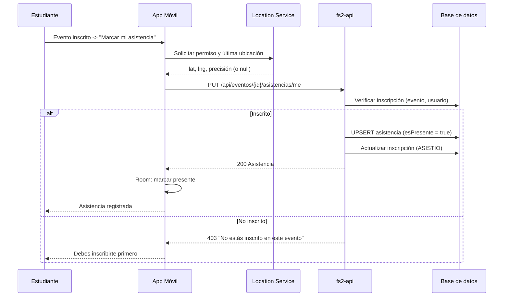
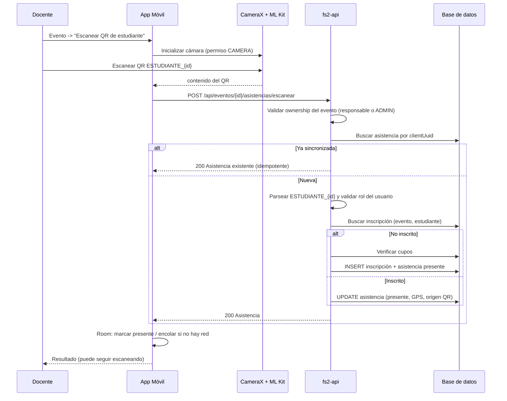
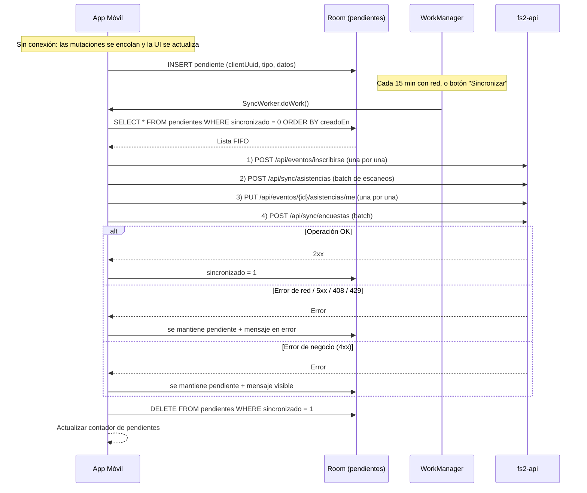
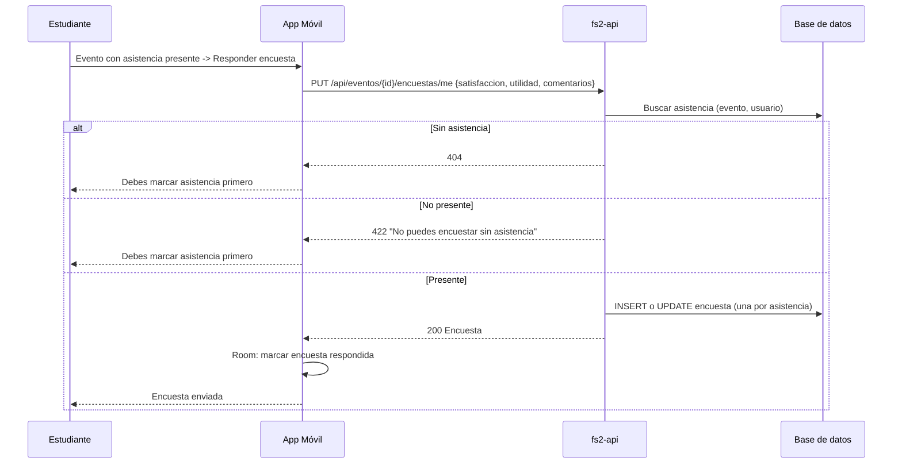

# 06. Interacción y Secuencias

Los diagramas reflejan la implementación real (backend `fs2-api` + app
`FormularioKotlin`). Todos los endpoints cuelgan de `/api`.

## SEQ-01: Autenticación Cognito Hosted UI + PKCE

Notas:

- El backend valida el **access token**; la app no usa el id token para las
  llamadas.
- No hay refresh token automático: si el access token expira, la app vuelve
  al login.
- Los roles provienen de los grupos de Cognito normalizados por el backend
  (`CognitoRoles`).

## SEQ-02: Inscripción a Evento (Online)

## SEQ-03: Marcar Asistencia Propia (Online)

La operación es idempotente por `(eventoId, usuarioId)`.

## SEQ-04: Escaneo QR de Estudiante por Docente (Online)

## SEQ-05: Sincronización Offline

El orden (inscripción → escaneos → asistencia propia → encuesta) respeta
las dependencias del backend. Ver
[13-OFFLINE-FIRST-Y-SINCRONIZACION.md](13-OFFLINE-FIRST-Y-SINCRONIZACION.md).

## SEQ-06: Responder Encuesta (Estudiante)

Si no hay red, la encuesta se encola como `ENCUESTA` y se sincroniza
después de que la asistencia haya sido confirmada por el backend.
