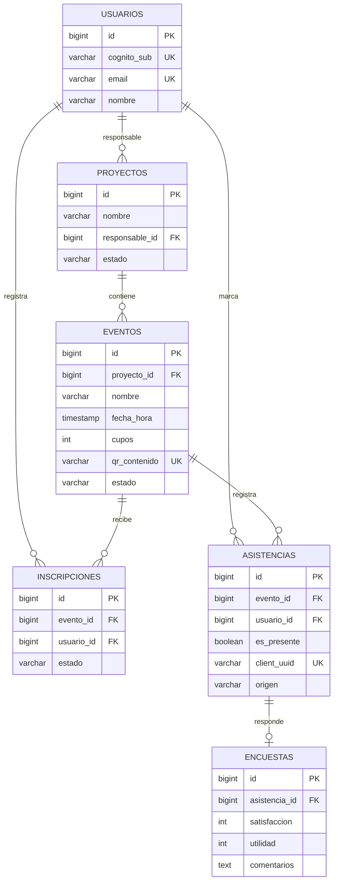

# 11. Modelo de Datos

El sistema usa **PostgreSQL** en el backend (JPA/Hibernate + Flyway) y
**Room (SQLite)** en la app como cache local y cola offline. No son
entidades idénticas: el backend es la fuente de verdad y Room guarda una
proyección optimizada para la UI.

## Modelo Backend (JPA)

### `usuarios`
| Campo | Tipo | Notas |
|---|---|---|
| `id` | BIGINT (PK, identity) | ID interno |
| `cognito_sub` | VARCHAR(128) | Unique; claim `sub` de Cognito |
| `email` | VARCHAR(320) | Unique |
| `nombre` | VARCHAR(160) | |
| `roles` | Colección (`usuario_roles.rol`) | `DOCENTE`, `ESTUDIANTE`, `ADMIN` |
| `creado_en` / `actualizado_en` | TIMESTAMP | Auditoría |

Los roles viven en la tabla `usuario_roles` (`usuario_id`, `rol`).

### `proyectos`
| Campo | Tipo | Notas |
|---|---|---|
| `id` | BIGINT (PK) | |
| `nombre` | VARCHAR(160) | Obligatorio |
| `descripcion` | TEXT | |
| `area_tematica` | VARCHAR(80) | |
| `unidad_vecinal` | VARCHAR(160) | |
| `fecha_inicio` / `fecha_fin` | DATE | |
| `estado` | VARCHAR(20) | `EstadoProyecto` |
| `responsable_id` | BIGINT (FK → usuarios) | Obligatorio |
| `creado_en` / `actualizado_en` | TIMESTAMP | |

### `eventos`
| Campo | Tipo | Notas |
|---|---|---|
| `id` | BIGINT (PK) | |
| `proyecto_id` | BIGINT (FK → proyectos) | Obligatorio |
| `nombre` | VARCHAR(160) | |
| `descripcion` | TEXT | |
| `fecha_hora` | TIMESTAMP | `LocalDateTime` |
| `cupos` | INT | `0` = cupos abiertos |
| `recinto` | VARCHAR(160) | |
| `direccion` | VARCHAR(240) | |
| `latitud` / `longitud` | DOUBLE | |
| `radio_metros` | INT | Default 200 |
| `qr_contenido` | VARCHAR(40) | Unique; `EVENTO_{id}` |
| `estado` | VARCHAR(20) | `EstadoEvento` |
| `creado_en` / `actualizado_en` | TIMESTAMP | |

### `inscripciones`
| Campo | Tipo | Notas |
|---|---|---|
| `id` | BIGINT (PK) | |
| `evento_id` | BIGINT (FK → eventos) | |
| `usuario_id` | BIGINT (FK → usuarios) | |
| `estado` | VARCHAR(20) | `INSCRITO`, `ASISTIO`, `CANCELADO` |
| `creado_en` | TIMESTAMP | |

**Unique:** `(evento_id, usuario_id)` (`uk_inscripcion_evento_usuario`).

### `asistencias`
| Campo | Tipo | Notas |
|---|---|---|
| `id` | BIGINT (PK) | |
| `evento_id` | BIGINT (FK → eventos) | |
| `usuario_id` | BIGINT (FK → usuarios) | |
| `es_presente` | BOOLEAN | |
| `marcado_en` | TIMESTAMP | |
| `latitud` / `longitud` | DOUBLE | |
| `precision_metros` | DOUBLE | |
| `origen` | VARCHAR(20) | `QR`, `MANUAL`, `SYNC` |
| `client_uuid` | VARCHAR(64) | Unique; idempotencia de escaneos |
| `creado_en` / `actualizado_en` | TIMESTAMP | |

**Unique:** `(evento_id, usuario_id)` (`uk_asistencia_evento_usuario`).

### `encuestas`
| Campo | Tipo | Notas |
|---|---|---|
| `id` | BIGINT (PK) | |
| `asistencia_id` | BIGINT (FK → asistencias) | Unique |
| `satisfaccion` | INT | 1–5 |
| `utilidad` | INT | 1–5 |
| `comentarios` | TEXT | |
| `enviado_en` | TIMESTAMP | |
| `creado_en` | TIMESTAMP | |

**Unique:** `asistencia_id` (`uk_encuesta_asistencia`): una encuesta por
asistencia.

### Enumeraciones

| Enum | Valores |
|---|---|
| `EstadoProyecto` | `PLANIFICADO`, `EN_CURSO`, `FINALIZADO`, `CANCELADO` |
| `EstadoEvento` | `PROGRAMADO`, `EN_CURSO`, `FINALIZADO`, `CANCELADO` |
| `EstadoInscripcion` | `INSCRITO`, `ASISTIO`, `CANCELADO` |
| `OrigenAsistencia` | `QR`, `MANUAL`, `SYNC` |

## Relaciones

```
usuarios 1──N proyectos (responsable)
proyectos 1──N eventos
eventos 1──N inscripciones
eventos 1──N asistencias
usuarios 1──N inscripciones / asistencias
asistencias 1──0..1 encuestas
```

## Diagrama ER



## Modelo Room (Móvil)

### `proyectos`
`id`, `nombre`, `descripcion`, `areaTematica`, `unidadVecinal`,
`fechaInicio`, `fechaFin`, `estado`, `responsableNombre`,
`responsableEmail`.

### `eventos`
`id`, `proyectoId`, `proyectoNombre`, `nombre`, `descripcion`,
`fechaHora`, `cupos`, `inscritos`, `presentes`, `recinto`, `direccion`,
`latitud`, `longitud`, `radioMetros`, `qrContenido`, `estado`,
`inscrito`, `esPresente`, `encuestaRespondida`, `actualizadoEn`.

Los campos `inscrito`, `esPresente` y `encuestaRespondida` son estado
optimista local para la UI.

### `perfil`
Tabla de una sola fila (`id = 1`): `usuarioId`, `nombre`, `email`,
`roles` (string separado por comas), `qrContenido`.

### `pendientes` (cola offline)
| Campo | Tipo | Notas |
|---|---|---|
| `clientUuid` | TEXT (PK) | UUID v4; idempotencia |
| `tipo` | TEXT | `INSCRIPCION`, `ASISTENCIA_PROPIA`, `ASISTENCIA_ESCANEO`, `ENCUESTA` |
| `eventoId` | INTEGER | |
| `codigoQr` | TEXT? | |
| `marcadoEn` | TEXT | ISO-8601 |
| `latitud` / `longitud` / `precisionMetros` | REAL? | GPS |
| `satisfaccion` / `utilidad` | INTEGER? | Encuesta |
| `comentarios` | TEXT? | Encuesta |
| `creadoEn` | INTEGER | Orden FIFO |
| `sincronizado` | INTEGER (bool) | Se elimina al confirmar |
| `error` | TEXT? | Último error |

No hay tabla local de inscripciones/asistencias/encuestas: el estado
visible se desnormaliza en `eventos` y en los contadores del backend.

## Restricciones e Índices

| Tabla | Restricción / Índice | Propósito |
|---|---|---|
| `usuarios` | `cognito_sub` UNIQUE, `email` UNIQUE | Identidad |
| `proyectos` | `responsable_id` | Ownership |
| `eventos` | `proyecto_id`, `qr_contenido` UNIQUE | Listado y QR |
| `inscripciones` | `(evento_id, usuario_id)` UNIQUE | Evitar duplicados |
| `asistencias` | `(evento_id, usuario_id)` UNIQUE | Una asistencia por evento |
| `asistencias` | `client_uuid` UNIQUE | Idempotencia de sync |
| `encuestas` | `asistencia_id` UNIQUE | Una encuesta por asistencia |
| `pendientes` (Room) | `clientUuid` PK; orden por `creadoEn` | Cola offline |

## Persistencia

| Entorno | Motor | Esquema |
|---|---|---|
| Backend `local` | H2 en memoria | `ddl-auto: create-drop` |
| Backend por defecto | PostgreSQL | Flyway + `ddl-auto: validate` |
| App | Room/SQLite | Migraciones de Room |

En el perfil `local` los datos se pierden al reiniciar el backend; en
PostgreSQL las migraciones de `src/main/resources/db/migration` son la
fuente del esquema.
