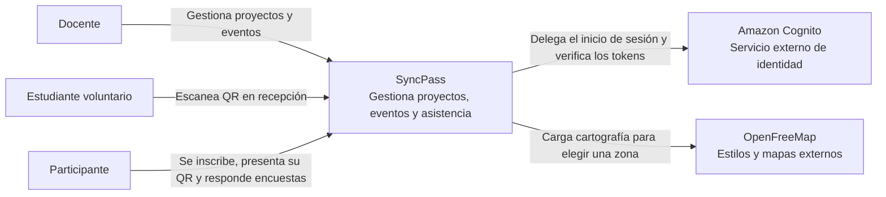
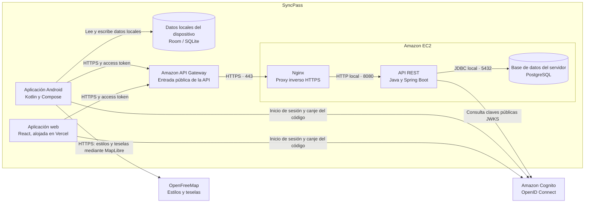
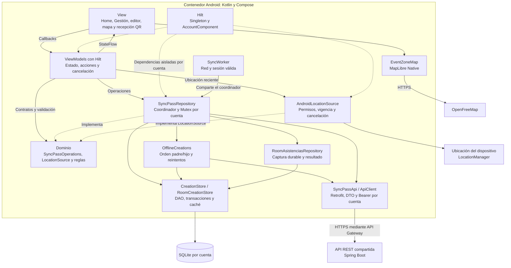

# Arquitectura y modelo de datos

## C1 · Contexto del sistema



## C2 · Contenedores y servicios de infraestructura



Los clientes obtienen sus tokens de Cognito y envían el access token a la API. Spring Security valida el token y el backend aplica los permisos. El diagrama muestra PostgreSQL en EC2, que es el despliegue documentado. Se mantiene PostgreSQL en EC2 conforme a la autorización docente; no se plantea una migración a Supabase en esta entrega.

## C3 · Componentes de la aplicación Android



Hilt proporciona dependencias mediante módulos y constructores. `AccountComponent` agrupa Room, API y repositorio para una cuenta; `AccountDependencies` cambia ese grupo al cambiar de usuario. El ámbito ViewModel recibe el contrato de operaciones de la cuenta activa. `SessionViewModel` conserva el almacén de ViewModels de navegación y lo limpia al cerrar sesión o cambiar de cuenta.

La cola de creaciones se procesa antes que la de inscripciones, asistencias y encuestas. `OfflineCreations` depende de la frontera `CreationStore`; `RoomCreationStore` aplica las transacciones del DAO. `RoomAsistenciasRepository` persiste la evidencia de captura y delega el envío al coordinador. El mismo Mutex coordina sincronización manual y trabajo de fondo.

Estos diagramas describen la entrega local. El despliegue de V3/V4 y la activación posterior de ENFORCE se registran en [el documento de EC2](17-DESPLIEGUE-BACKEND.md). V5 de códigos públicos sigue siendo una migración local pendiente de despliegue.


`AccountComponent` y `AccountDependencies` construyen y administran las dependencias por cuenta. En ejecución, cuando un ViewModel llama a un contrato de dominio, la operación se ejecuta en su repositorio concreto. Compose vuelve a dibujar la interfaz cuando cambia el estado observable.

### Vista general del despliegue

```text
Android: Compose -> ViewModel -> contrato de repositorio
                                  |-> Room / SQLite
                                  |-> Retrofit / OkHttp
                                              |
                                          HTTPS API Gateway
                                              |
                                          HTTPS Nginx (EC2)
                                              |
                                     Spring Boot (127.0.0.1:8080)
                                              |
                                     PostgreSQL (127.0.0.1:5432)

Cognito Hosted UI -> callback Android -> sesión local
Cognito JWKS -> validación del access token en Spring Security
```

Es un cliente móvil con backend por capas y base de datos relacional. API Gateway enruta; no contiene las reglas de negocio. Cognito gestiona la autenticación, mientras Spring autoriza cada operación. SyncPassWeb consume la misma API desde otro repositorio.

## Frontend Android: MVVM con repositorios

Paquete base: `com.rojas.syncpass`, dentro de `Android/app/src/main/java/`.

| Ubicación | Responsabilidad | Ejemplos |
|---|---|---|
| `ui/` | Composición visual, navegación y eventos del usuario | HomeScreen, GestionScreen, EventoDetalleScreen, QrScannerScreen |
| `ui/*/*ViewModel` | Coordinar operaciones y construir estado observable | HomeViewModel, GestionViewModel, ScannerViewModel |
| `domain/` | Contratos, modelos y errores del negocio | Repositories.kt, Models.kt, AppException |
| `data/repository/` | Acceso coordinado a fuentes remotas/locales | SyncPassRepository, ApiProyectosRepository, RoomRecintosRepository |
| `data/remote/` | Contratos Retrofit, DTO HTTP y conversión de errores | SyncPassApi, ApiModels, ApiClient, ResultBoundary |
| `data/local/` | Tablas SQLite, consultas y transacciones Room | SyncPassDatabase, SyncPassDao, RecintoDao, Entities |
| `data/mapper/` | Conversión entre DTO, entidades y dominio | ModelMappers |
| `data/session/` | Sesión y cifrado de tokens | SessionStore, TokenVault |
| `core/` | Configuración, formato y lectura JWT | AppConfig, FormatoFechaHora, JwtDecoder |
| `data/location/` | Fuente de ubicación del dispositivo | AndroidLocationSource |
| `di/` | Inyección y aislamiento por cuenta | SessionModule, AccountComponent, LocationModule |
| `work/` | Ejecución diferida de la sincronización | SyncWorker, SyncScheduler |

`SyncPassApplication` utiliza `@HiltAndroidApp` y `MainActivity` es un punto de entrada de Hilt. Los ViewModels se obtienen con `hiltViewModel`. Los módulos proveen sesión, API, Room, repositorios y ubicación. El módulo `:cognito-auth` encapsula AppAuth y el flujo OIDC; la app mantiene la navegación y la persistencia de sesión. Véase [la migración a Hilt](09-INYECCION-HILT.md).

Los ViewModels usan `viewModelScope`, Flow/StateFlow y estados inmutables. Compose recibe estado y callbacks; los composables no acceden directamente a SQL o Retrofit. Room emite los cambios de datos que alimentan la UI. `stateIn` y `WhileSubscribed` permiten compartir flujos durante la observación.

Se utiliza MVVM con separación presentación/dominio/datos, no una implementación estricta de Clean Architecture: no existe una clase de caso de uso para cada acción y `SyncPassRepository` sigue coordinando varias capacidades. La delegación de proyectos y recintos, `RoomAsistenciasRepository` y `OfflineCreations` separa responsabilidades concretas sin crear una clase por cada acción.

### Dashboards

Android utiliza `HomeScreen` compartida con secciones y acciones condicionales de `HomeUiState`. No son tres Activities ni tres pages React separadas. Cambian el encabezado, los botones, las métricas y las acciones del detalle según rol. La navegación se centraliza en `ui/navigation/SyncPassApp.kt`.

### Ejemplo: editar evento

`EventoEditorDialog` valida los pasos y genera `EventoInput`. `EventoDetalleViewModel` verifica que se pueda gestionar el proyecto y llama a `SyncPassOperations.editarEvento`. El repositorio envía PUT mediante Retrofit; Spring valida DTO, rol y propiedad; el servicio actualiza la entidad en una transacción. Solo con respuesta exitosa se actualiza Room. El flujo emite el nuevo evento y la interfaz cierra la edición tras la confirmación. Un error conserva el formulario.

### Ejemplo: recinto local

`GestionScreen` -> `GestionViewModel` -> contrato de recintos -> `RoomRecintosRepository` -> `RecintoDao` -> SQLite. No existe solicitud HTTP para guardar el recinto. Elegirlo en el formulario copia sus campos al evento; guardar ese evento conserva los valores en la solicitud local y los envía a la API al sincronizar.

## Backend fs2-api: Spring por capas

Ruta comprobada en este repositorio: `Backend/src/main/java/com/duoc/cursos/`. El nombre histórico del paquete y servicio sigue siendo `cursos`; el producto es SyncPass.

| Paquete | Función |
|---|---|
| `controller` | Rutas, validación de entrada, permisos de método y delegación; devuelve DTO |
| `service` | Reglas del negocio, propiedad, transacciones, inscripciones, asistencia y encuestas |
| `repository` | Interfaces Spring Data JPA y consultas/bloqueos de persistencia |
| `model` | Entidades y enumeraciones; relaciones de datos |
| `dto` | `ApiDtos`, records de solicitudes, respuestas y errores |
| `security` | Normalización de grupos, validación de access tokens y sincronización del usuario |
| `integration` | Comunicación con Cognito mediante AWS SDK |
| `config` | Spring Security, CORS y clientes AWS |
| `exception` | Traducción centralizada de excepciones HTTP y validación |

La inyección del backend se realiza por constructor. Spring Security configura un Resource Server JWT sin sesión HTTP. `UsuarioSincronizadoFilter`, `SesionUsuarioService` y `PerfilUsuarioWriter` relacionan la identidad Cognito con el usuario local. Los servicios usan `@Transactional`. JPA mantiene entidades; los controladores retornan records y no las entidades completas.

No existe un mapper independiente para todo: conversiones como `toResponse` están en servicios. Esto es una decisión del código actual, no una omisión que deba ocultarse. El controlador health construye una respuesta simple; no ejecuta lógica del negocio.

## Modelo de datos

- Usuario: identidad local, vínculo Cognito, nombre y roles. Un usuario participa en inscripciones y puede ser responsable de proyectos.
- Proyecto: ID interno, código público único, nombre, descripción, área temática, unidad vecinal, fechas, estado y responsable. Tiene varios eventos.
- Evento: ID interno, código público único, proyecto, datos de actividad, LocalDateTime, cupos, ubicación, radio, QR y estado.
- Inscripción: une usuario y evento, con estado y fecha de creación.
- Asistencia: une usuario y evento, presente, timestamp, origen, ubicación opcional y clientUuid.
- Encuesta: asociada a asistencia; satisfacción, utilidad, comentarios y fecha.
- Recinto local: nombre, dirección, coordenadas y radio; no es una entidad de la API.
- Pendiente local: tipo de operación, evento, UUID, contenido necesario y estado/error de envío; conserva la hora de posición y de captura para asistencia.
- Creación local: UUID, tipo, payload inmutable, proyecto dependiente, estado/error y correspondencia local-remota.
- Reserva de código público: código aleatorio con prefijo PRY/EVT, único y no reutilizable; se reserva en la transacción de creación del recurso.
- Creación de servidor: usuario, tipo, UUID, huella e ID remoto, guardados junto al recurso en una transacción.
- Evidencia geográfica: hora de posición, estado y motivo de evaluación; los registros históricos pueden carecer de estos campos.

Los conteos de inscritos/presentes se calculan en el servidor; no son una autorización aportada por el cliente. Las fechas de eventos usan `LocalDateTime` sin zona; los timestamps de asistencia/envío usan `Instant`.

Room mantiene caché de perfil, proyectos y eventos, además de recintos y pendientes. PostgreSQL mantiene las entidades del negocio. Las migraciones del servidor están en `Backend/src/main/resources/db/migration/`; Flyway aplica el esquema y Hibernate lo valida. El perfil local H2 crea y descarta el esquema para desarrollo.

## Límites arquitectónicos

La base local no es una réplica completa de todas las tablas del servidor. Las listas de asistentes y encuestas se consultan remotamente. Las consultas de conteos por evento pueden aumentar el número de accesos JPA con catálogos grandes; no hay benchmark de carga ni paginación completa que justifique prometer escalabilidad ilimitada.

## Flujo de creación offline

La View envía un formulario al ViewModel. El coordinador valida y guarda una creación y su tarjeta local en una transacción. Al sincronizar, verifica la capacidad idempotente del backend, envía primero el proyecto y confirma su correspondencia en Room; luego envía sus eventos con el ID remoto. Una interrupción conserva la solicitud y el UUID para reanudar. La API usa `CreationIdempotency`, bloqueo por usuario y una restricción única para recuperar el mismo recurso ante reintentos.

## Flujo geográfico de recepción

El receptor lee el QR del participante en un evento confirmado. `ScannerViewModel` obtiene una ubicación reciente mediante `LocationSource`, valida su precisión y margen dentro de la zona y guarda la captura antes de enviarla. El backend vuelve a evaluar con la zona actual mediante `AttendanceLocationPolicy`. `AUDIT` conserva clientes anteriores y registra el resultado; `ENFORCE` rechaza incumplimientos. Los detalles y límites están en [la política geográfica](11-GEOLOCALIZACION-ASISTENCIA.md).

## Presentación del filtro y códigos públicos

HomeViewModel conserva el filtro de estado en SavedStateHandle y deriva eventosVisibles del catálogo del repositorio. Compose muestra resultados y cantidad; el filtro no consulta HTTP ni altera Room. La lista conserva desplazamiento vertical sin paginación.

El backend reserva el código público en PostgreSQL dentro de la misma transacción que crea el recurso. Su respuesta lo incorpora al DTO; los mappers Android lo conservan en Room V6 y dominio. La View lo muestra como dato secundario. Los registros pendientes no generan códigos definitivos en el dispositivo. Véanse los documentos [18](18-FILTRO-ESTADO-EVENTOS.md) y [19](19-CODIGOS-PUBLICOS.md).
